# StackFlowOS

**一个给 Agent 住的系统。**

不是更好的聊天软件，也不是又一个任务看板。它把 Agent 当成"住在机器里的进程"：
有地址、有生命周期、有资源租约、有失败域、有审计，所有高风险动作走统一审批口。

- 对话是入口，工作面板是现场（`对话 + 项目卡片 + 任务 + 实时事件`）
- L0 用 **pynng**，`ipc://` 与 `tcp://` 同一种 wire 协议，进程内进程外一套代码
- L1 继承 **Cordis** 的内核语义：`Context` 树、`effect`/disposer 逆序回收、服务注入、类型化事件
- L2 是真正新建的部分：**能力目录 · 租约 · 失败域 · append-only 事件流**
- 项目是卡片，Agent 是工人：随项目生、随项目死，另有管理推进与数据汇总角色
- 每个工人 Agent 是一个独立进程；危险动作走审批；放行规则由人定义，审计只读、不可改
- **系统助手是操作员代理**：通过对话下达的管理指令直接执行（含审批放行/拒绝、
  改配置、归档/删除项目），每次动作写入 `operator.action` 审计；工人仍受审批约束
- **每个 Agent 也能单独对话**：在「Agent」里点成员进入 `#agent/<id>`，用它的角色、
  项目工作区和工具直接干活；一个对话线程按 Agent 持久保存，流式回复与工具调用可见
- **自治闭环（默认关闭）**：`autonomy.0` 周期性自己巡检系统，把发现转成任务/派工，
  并在人预先划定的能力/风险/项目/配额围栏内代理审批；每一步写事件，可一键急停

> 设计与判断的完整推导见 [docs/vision.md](docs/vision.md)，
> 实现契约见 [docs/architecture.md](docs/architecture.md)，
> 自举/自改进操作手册见 [docs/self-hosting.md](docs/self-hosting.md)，
> 单元模型（sys/审批/LLM/工具/上下文/插件/skill）见 [docs/units-plan.md](docs/units-plan.md)。

---

## 快速开始

环境：Linux、Python ≥ 3.11、`pynng`（已安装 0.9.0 时无需其他依赖）。

```bash
# 1) 启动系统（默认 IPC；终端会打印带 ?token= 的登录 URL）
python3 -m stackflowos hub

# 2) 一键演示：自动建项目、派 Agent、真实写文件、跑自检
python3 -m stackflowos demo --until-done
#    不带 --until-done 时 hub 会保持运行，打开终端打印的登录 URL 即可看界面

# 3) 换 TCP 传输（同一套协议，地址从 ipc:// 变成 tcp://）
python3 -m stackflowos hub --transport tcp

# 4) 环境自检 / 查看正在运行的 hub
python3 -m stackflowos doctor
python3 -m stackflowos status --token "$SFO_WEB_TOKEN"
```

`demo --until-done` 会真的在 `.stackflowos/projects/<id>/workspace/` 里留下设计文档、
实现文件、测试报告和评审意见，并在终端打印任务终态与产物路径。演示项目目标是
"Markdown → HTML 命令行工具"，产出的 `src/*.py` 是可运行的真实程序
（`python3 src/t-3-*.py --selftest` 会通过），最后由 aggregator 写出项目简报。

演示会预置一组**项目范围内**的放行规则（只允许项目工作区内的读写和无害命令），
这是"人给系统定的规矩"，不是绕过审批；项目之外的写入仍然会弹审批。

---

## 界面

控制台是 **React 19 + [Astryx](https://github.com/meta/astryx) 设计系统** 的单页应用
（源码在 `webui/`，构建产物由 hub 直接托管）。首屏是**对话框**，右侧是**现场面板**
（项目进度 / 在岗 Agent / 实时事件），左侧导航打开八个屏：

| 屏幕 | 内容 |
|---|---|
| 对话 | 系统助手对话（流式回答、工具调用、快捷建议）+ 现场面板；高风险动作仍需人工审批 |
| 项目 | 项目列表（状态 / 进度 / 任务计数）；创建与**接入已有目录**；详情含任务看板、依赖图、Git 面板、健康检查、归档 / 永久删除（输入项目名二次确认） |
| Agent | 花名册（按项目分组、角色 / 状态过滤、派工、终止）；点成员进入**该 Agent 的独立对话**（角色工具 + 项目现场 + 流式工具卡片） |
| 单元 | 按层（system / service / worker）的进程表：状态、能力、运行时、心跳；抽屉里看 descriptor、requires/wants 依赖图、最近事件与探测 / 重启 / 摘除 / 终止 |
| 审批 | 待审批队列（风险 / 范围 / 预览 / TTL）、放行规则编辑器、已决定审计 |
| 事件 | 实时事件流：类型 / 项目 / 搜索过滤，暂停跟随，行内展开原始 JSON |
| 自治 | 巡检发现、自主派工、代理审批理由；开关 / 模式 / 配额 / 能力白名单；一键巡检与急停 |
| 设置 | 常规 / 安全（会话撤销、轮换、登出）/ AI（用量、预算、路由、JSON 编辑）/ 能力（Skills、Plugins、MCP） |

界面支持中文 / English、浅色 / 深色 / 跟随系统，以及窄屏单列布局；`#agent/<id>`、
`#/projects/<id>` 等深链保持可用。

### 前端构建

运行时不需要 Node：`python3 -m stackflowos hub` 直接托管
`stackflowos/webassets` 里的构建产物。只有改界面时才需要 Node（≥ 20）：

```bash
cd webui && npm install
npm run dev            # http://127.0.0.1:5180，/api 代理到 scripts/ui_mock.py
./scripts/build_webui.sh   # tsc 类型检查 + 构建到 stackflowos/webassets
```

设计系统版本、屏幕/字典/共享层契约见 [`webui/README.md`](webui/README.md)。

### 截图（真实运行中的 hub）


| 审批口（风险 / 范围 / 预览 / TTL） | 项目详情（任务 / 依赖 / Git） |
|---|---|
| 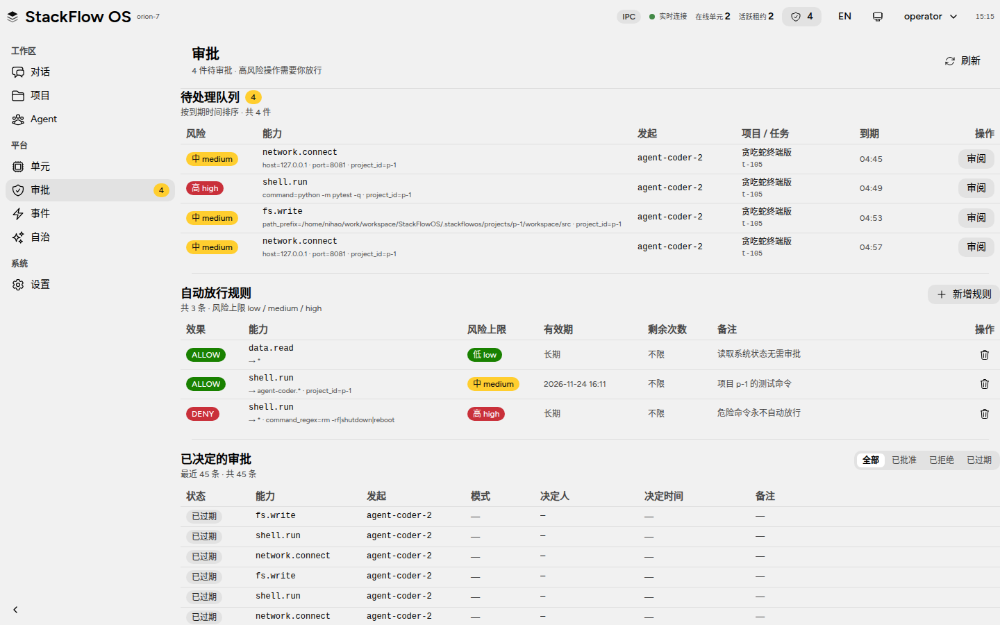 | 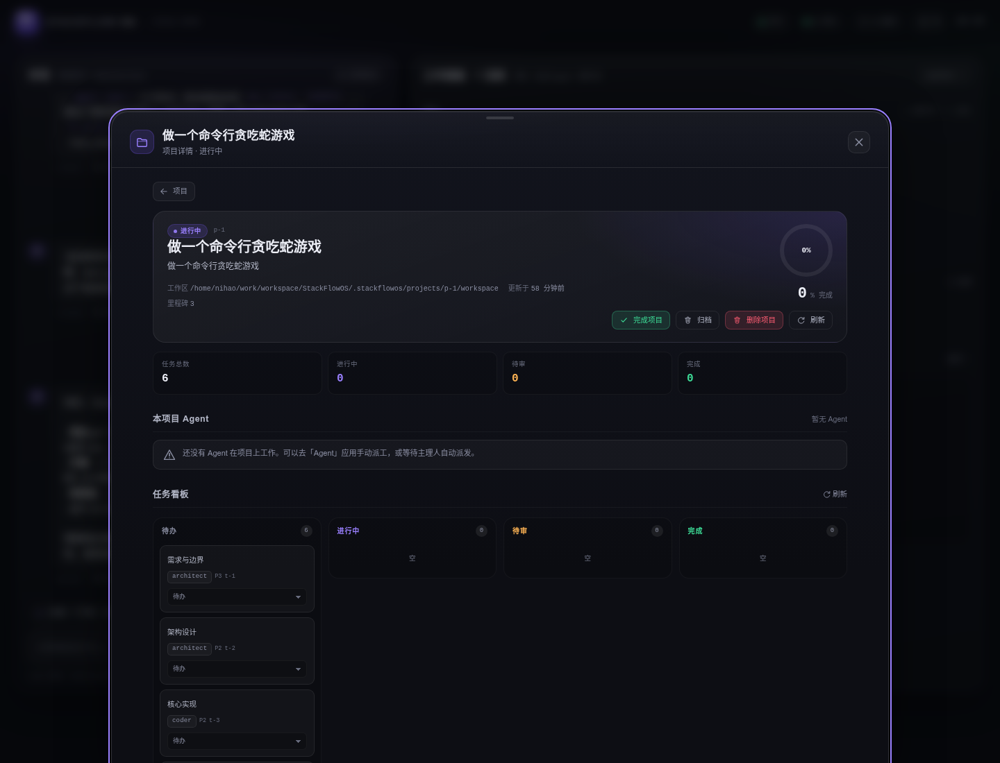 |

| 单元（分层进程表 + 依赖图） | 自治（巡检 / 派工 / 代理审批） |
|---|---|
| 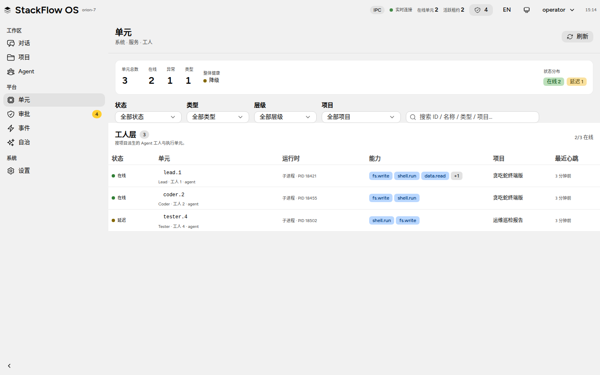 | 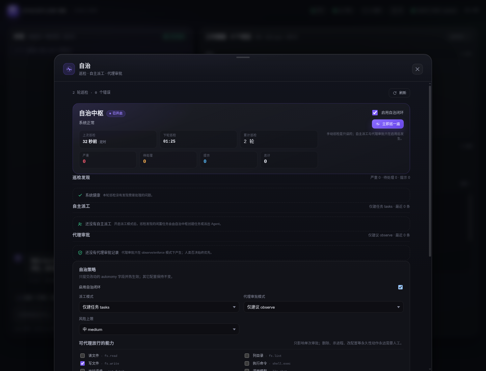 |

| 手机宽度 | 设置 |
|---|---|
| 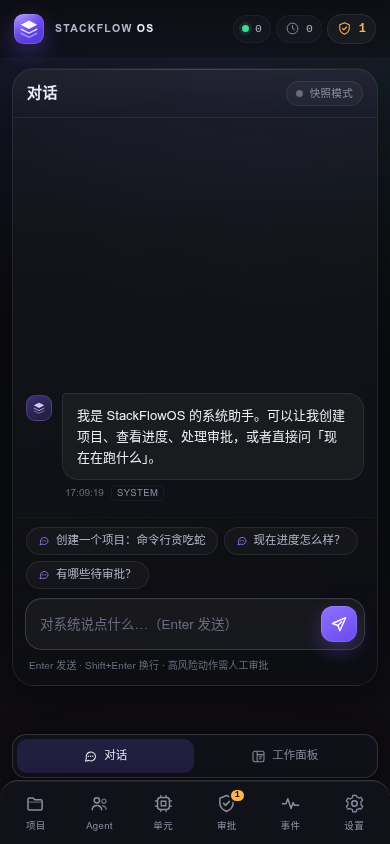 | 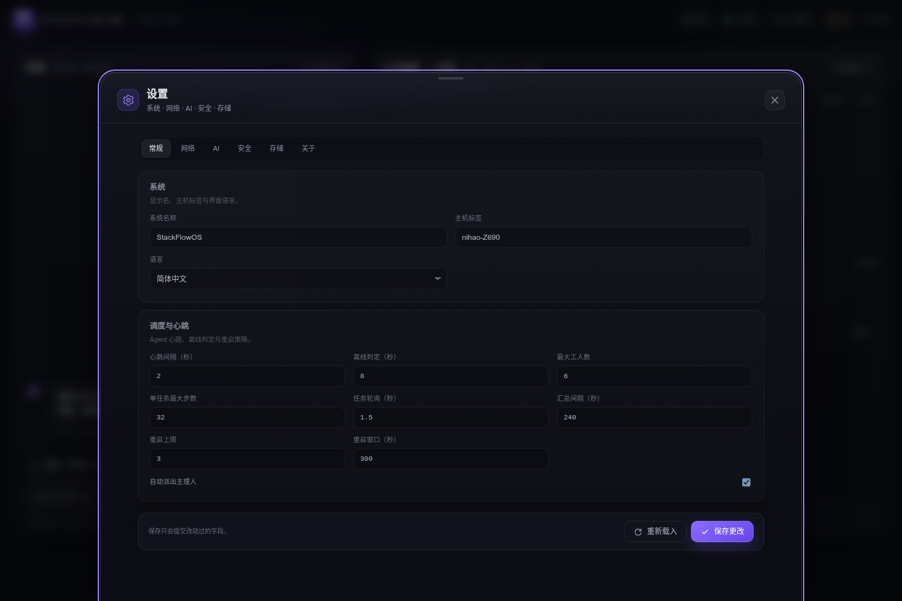 |

| 项目列表 | Agent 花名册 | 事件控制台 |
|---|---|---|
| 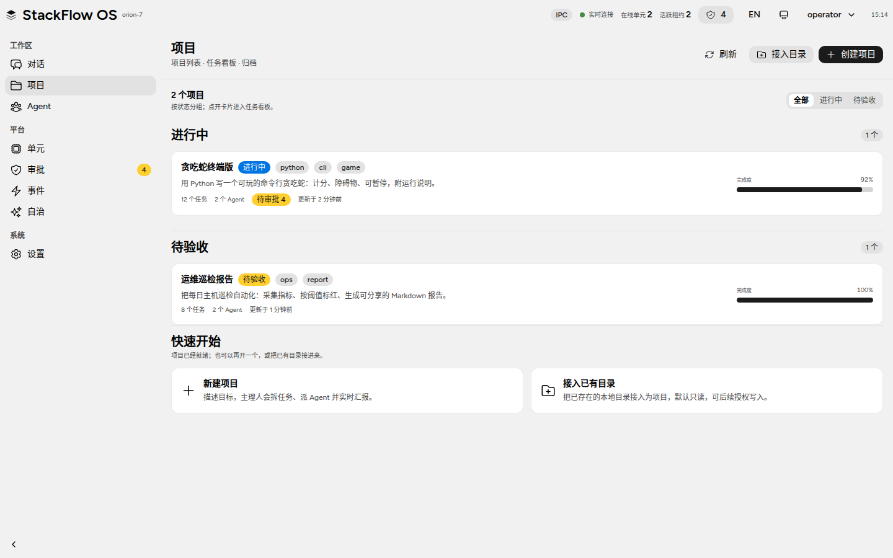 | 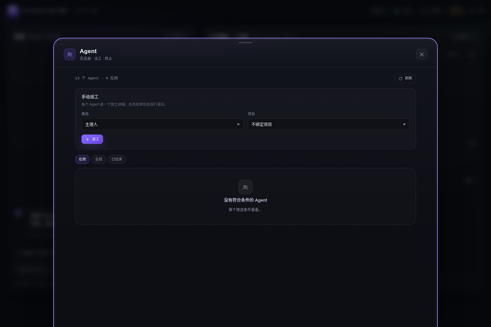 | 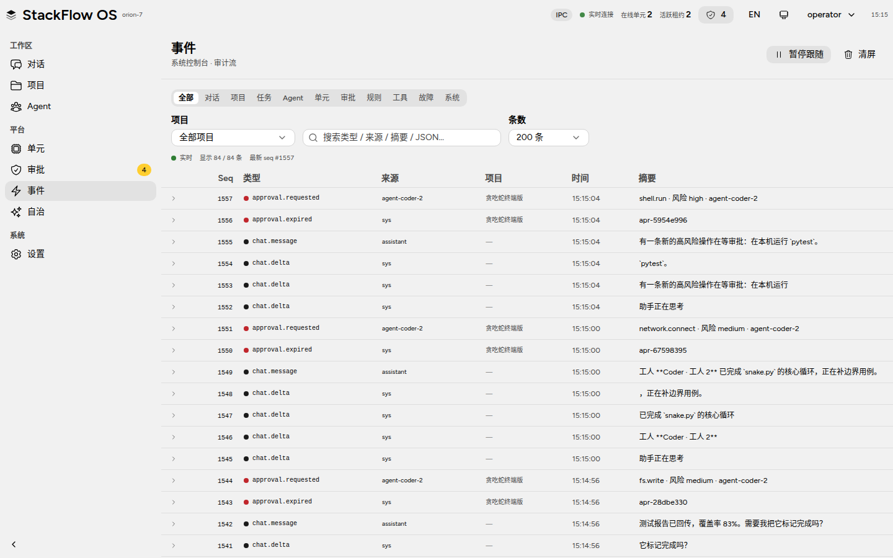 |

### Agent 对话

导航里的「Agent」每一行都是入口：点进去是这个 Agent 的独立对话与现场。

- **用它的身份工作**：system prompt 是该角色的职责与工具集，工具在项目 workspace 内执行；
  文件/命令/任务动作仍走同一套能力审批，审批提醒会直接出现在对话上方。
- **有现场**：右侧同时显示项目进度、当前任务、任务列表、最近活动、Agent 元数据与工作区。
- **是会话，不是回放**：每个 Agent 一个线程，持久化在
  `.stackflowos/state/agent-chat/<agent_id>.json`；SSE 流式回复、工具调用状态、
  「停止本轮」和「清空对话」都实时生效。`#agent/<id>` 可直接深链。
- **已结束的 Agent 也能继续对话**：线程属于 Agent 记录；进程退出不会丢掉对话，
  继续对话会以同一角色身份工作（动作仍受审批约束）。
- 一次只跑一轮：同一 Agent 的并发消息返回 409；停止本轮会把它自己创建的待审批请求一并拒绝。
- **实现边界**：对话轮在 hub 内以该 Agent 身份运行，不会复活它已退出的 worker 进程；
  角色工具、workspace 限制、审批 owner 与审计和 worker 保持一致。

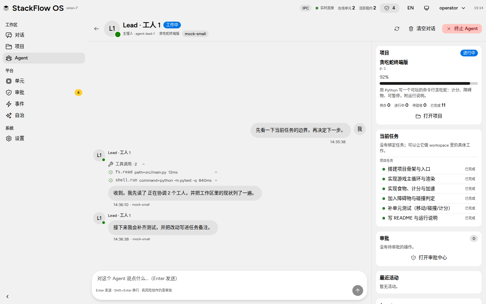

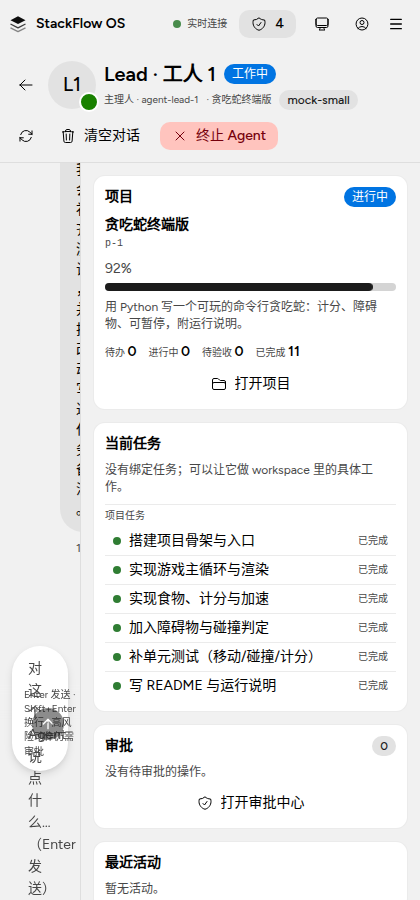

---

## 架构

```
┌──────────────────────────────────────────────────────────────┐
│ 对话 + 工作面板（Web / SSE / React 19 + Astryx，预构建资源）    │
├──────────────────────────────────────────────────────────────┤
│ L2 sys 单元                                                   │
│   能力目录  Registry · 租约 Lease · 失败域 Failure             │
│   调度 Scheduler · 事件流 EventLog · 项目/任务 · 权限审批       │
├──────────────────────────────────────────────────────────────┤
│ L1 内核 Context 树 / effect / 服务注入 / 事件语义（Cordis 风格）│
├──────────────────────────────────────────────────────────────┤
│ L0 pynng 传输 REQ/REP（控制面）+ PUB/SUB（事件面）             │
│   地址：ipc://<run>/<work_id>.rpc.sock | tcp://host:port      │
└──────────────────────────────────────────────────────────────┘
```

进程拓扑：

```
hub 进程（sys.0）
 ├─ pynng REP  : 所有单元的 RPC（allocate/register/heartbeat/lease/approval/...）
 ├─ pynng SUB  : 聚合所有单元的事件
 └─ Web/SSE    : 浏览器

worker 进程（coder.3 / lead.2 / reviewer.7 ...）
 ├─ 自己的 REP : 接收 hub 的 unit.pause/resume/kill/status
 ├─ 自己的 PUB : 把事件发给 hub 的 SUB
 └─ 本地执行工具: 读写项目工作区、跑命令；动作前向 sys 申请能力
```

**为什么一个 Agent 一个进程？** 因为"进程"是真实世界里的隔离、生命周期与
资源归属单位。worker 崩了是失败域问题，不是异常处理问题；项目归档时杀进程，
比"把状态标记成归档"更接近一个系统该有的行为。

### IPC 与 TCP 是同一件事

`pynng` 的 NNG 协议在两种 transport 上是同一套消息语义。切换只改配置：

```python
transport.mode = "ipc"   # ipc://<state>/run/<work_id>.rpc.sock
transport.mode = "tcp"   # tcp://127.0.0.1:<port>（远程监听需 transport.allow_remote=true）
```

IPC 的 socket 路径受 `sockaddr_un`（约 100 字节）限制；状态目录过深时，hub 会自动把 socket
放到 `<tmp>/sfo-<hash>`，`stackflowos doctor` 会给出警告。

单元启动时向 sys 要地址（`unit.addresses`），然后绑定自己的 REP/PUB。
换设备时，把 hub 的 `sys_rpc` 换成 `tcp://<host>:<port>` 即可让那台设备上的
worker 接进来——语义上它就是同一台机器上的另一个进程。远程监听默认关闭：
`transport.host` 必须是 loopback，要绑定具体网卡/通配地址需显式
`transport.allow_remote = true`（详见下方「配置」）。

---

## 核心概念

### 单元（Unit）

一个可寻址的运行实例，`work_id = <kind>.<n>`，等价于 PID：

- `sys.0`：内核 + sys 单元
- `lead.2`：项目主理人，与项目同生灭
- `coder.3`：任务工人，任务结束即退出
- `agg.1`：数据汇总，周期性更新项目 brief

单元注册时声明**能力**（不是"我装了什么"，而是"我现在能承诺什么"），
心跳超时后进入 suspect → offline，由失败域决定重启、降级还是隔离。

### 租约（Lease）

```python
lease = {
  "resource": "project:p-1:lead",   # 或 unit:coder.3 / file:<abs> / cap:<name>
  "holder": "lead.2",
  "ttl_s": 300, "renewable": True, "preemptible": False,
}
```

同一资源同时只有一个持有者；冲突返回持有者信息，可抢占资源按优先级抢占。
到期自动释放并广播 `lease.expired`。**没有租约，AI 不敢接长任务**——
"我占着这块资源到什么时候"必须能被回答。

每个 unit 注册时会自动持有 `unit:<work_id>` 的身份租约，心跳续期、退出或失联时
由失败域释放；它让"进程占着这个地址到什么时候"成为可查询事实，也直接显示在
状态栏的租约计数里。

### 失败域（Failure Domain）

单位死亡不是"一个报错"，是一组后果：

1. 释放它持有的全部租约；
2. 发送 `unit.offline` / `failure.detected`；
3. 按 kind 的策略重启（有预算、有窗口，不允许无限重启）；
4. 超预算 → 隔离（quarantined），项目标记 degraded；
5. 它名下的任务回到 `todo`，让主理人重新派工。

### 事件流（Event Log）

append-only JSONL（`<state>/events/events.jsonl`），全局单调 `seq`，
支持 `since(seq)` 增量与按 **agent / source / type / 时间窗** 回放
（`sfo events --agent agent-coder-1 --since-ts ...`，API `GET /api/events?agent_id=...`，
Agent 工具 `event.query`）。UI 的 SSE 断线后按 `lastSeq` 续传。
聊天、审批、任务、Agent 的一生都在同一条流里——审计不是另一张表。

### 已有目录 → 项目

项目有两种工作区：

- **系统工作区**：新建项目时由系统分配 `<state>/projects/<id>/workspace`；
- **接入已有目录**：在项目页「接入已有目录」，或对话里说
  「打开 /home/you/project 这个项目」。系统只登记路径，不复制、不移动、不删除。
  默认 **只读**（Agent 可读/列，写文件和 shell 被拒绝）；勾选“允许 Agent 写入”
  （或在对话里说“把 StackFlowOS 改成可写”）才切到可写，写操作仍走能力审批；
  项目详情可随时切回只读。删除项目只删登记记录，外部目录永远保留。

### 项目入住（Agent Onboarding）

Agent 进入空 workspace 时最缺的不是功能，是信号。项目创建/接入时会写入：

- **门牌** `brief.md`：项目 id/目标/workspace/目录约定/审批边界/自检命令；
- **固定骨架**：`tasks/`（中间产物）、`artifacts/`（交付物）、`logs/`（执行记录）、
  `tmp/`（草稿）；
- **种子任务**「入职自检」：读 brief → `project.health` → 写 artifact → 登记 → review，
  让空项目也能完成一次完整闭环；
- **记忆初值**：goal / workspace / layout / conventions / glossary，Agent 不再从零猜；
- **一条自检入口**：`project.health` / `sfo project health <id>` /
  `GET /api/projects/{id}/healthcheck`，逐项检查 scope、workspace、骨架、看板、
  记忆、读预授权与审计，失败项带 `fix`。

读类动作（`fs.read/fs.list/task.list/project.get/memory.list/project.health`）默认低风险
自动放行；写/执行/网络保持人审。完整契约见 [`docs/onboarding.md`](docs/onboarding.md)。

### 权限（Capability → Risk → Policy → Approval → Grant → Audit）

能力不是布尔开关，带范围和风险：

| 能力 | 风险 | 范围 |
|---|---|---|
| `fs.read` / `fs.list` | low | path |
| `fs.write` | medium | path（项目工作区外升 high） |
| `fs.delete` | high | path |
| `shell.exec` | high | cwd + command（危险模式始终 high） |
| `net.fetch` | medium | url |
| `agent.spawn` | medium | project + role |
| `unit.control` / `sys.config` | high | work_id / section |

判定顺序：**deny 优先 → 允许规则（risk_max 且范围匹配）→ 默认策略**
（low 可自动放行，medium/high 默认询问）。

审批口就是手机 App 的权限弹窗：

- **允许一次**：一次性 grant，用完即失效
- **允许 1 小时**：session grant，按角色泛化（`agent-coder-3` → `agent-coder-*`），
  读写类限定在项目工作区、`shell.exec` 仍精确到该命令、网络按域名；危险能力（删除/终止等）保持精确
- **总是允许**：落成一条同样泛化的规则，可在设置里删除
- 放行后，同一批还在排队的同类请求会自动通过（`approval.auto`）；新增/修改规则也会立即生效于排队请求
- **拒绝**：动作失败，Agent 收到 `DENIED`
- 没人处理时到期自动拒绝（fail closed）
- 放行规则可限定 principal（`coder.*`）、路径前缀、命令正则、域名、项目、风险上限

Agent 终态分两种，UI 和事件流分开显示：

- `blocked`：缺前置条件/到预算上限（无 project scope、workspace 缺失、任务不存在或
  已被认领、max_steps、任务超时、工具次数上限、连续失败）；补条件即可重派；
- `failed`：执行期真的出错（异常、LLM/工具崩溃）；需要查 bug。

两者都带非空 `error` 和机器可读 `error_code`（如 `WORKSPACE_MISSING`、
`MAX_STEPS`、`AGENT_CRASH`）。派工现在强制要求项目 scope 与可用 workspace。

执行模型是**能力委托**：worker 在本地执行，sys 授权并审计。这对应内核给进程发 fd；
已知限制是 worker 本身可信（见"边界"）。

**操作员助手**：对话框里的「系统助手」是人的代理，拥有系统管理权限——项目/任务/
Agent/单元/审批/规则/配置/租约/项目文件都能直接操作，不再弹审批；代价是它不能
碰宿主 shell，且每次调用都写入不可变的 `operator.action` 事件。工人 Agent 不共享
这个特权，仍走审批。

### 自治闭环（巡检 / 派工 / 代理审批）

系统里常驻一个 `autonomy.0` 单元。打开后它做三件事，形成一个闭环：

1. **巡检**：周期收集 health/单元/项目/任务/Agent/审批/租约/事件，用一组只读检查
   产出 findings（任务闲置、审批积压、单元失联、失败突发、项目未入住……）；
   只对新出现的问题写 `autonomy.finding`，不刷屏。
2. **派工**：带 `DispatchHint` 的 finding 在配额与冷却内变成任务 / 工人——
   空项目拉 lead，闲置 todo 任务拉对应角色；同 fingerprint 不重复、同任务不重派。
3. **代理审批**：在**人预先划定的围栏**内（能力白名单、风险上限、项目/角色过滤、
   路径必须在 workspace、每小时上限、人类否决冷却）以 `autonomy:guardian` 身份
   逐条放行 pending 审批，写 `approval.decided` + `autonomy.approval`。
   删除文件、杀进程、改配置/规则、项目管理**永远**需要人。

```json
{"autonomy": {"enabled": true, "dispatch_mode": "agents",
              "approve_mode": "enforce", "approve_risk_max": "medium",
              "approve_capabilities": ["fs.write", "agent.spawn"]}}
```

三个开关互相独立：`enabled` 是总闸，`dispatch_mode=off|tasks|agents`，
`approve_mode=off|observe|enforce`。**默认全关**；建议先 `observe` 看它"会怎么批"，
再打开 `enforce`。`shell.exec` 默认不自动放行，需要人写下命令正则白名单并显式
`approve_shell=true`；`net.fetch` 需要域名白名单。

GUI 的「自治」应用显示 findings、派工记录、每条审批理由，并提供开关/模式/配额/
能力白名单；`sfo autonomy status|patrol|set` 是同一控制面的 CLI；
`POST /api/autonomy/patrol` 可立即巡一轮，`PATCH /api/autonomy/policy` 改策略。
完整检查表、围栏与残余风险见 [docs/autonomy.md](docs/autonomy.md)。

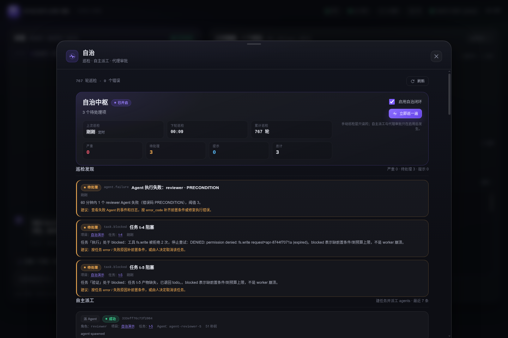

### Agent 角色

| 角色 | 生命周期 | 职责 |
|---|---|---|
| `lead` | 随项目 | 拆解目标、建任务、派工、推进、汇总 |
| `architect` / `coder` / `tester` / `reviewer` / `researcher` | 随任务 | 设计 / 实现 / 测试 / 评审 / 调研 |
| `aggregator` | 项目内周期（默认 240s / demo 收尾时一次） | 读事件与任务，更新项目 brief |
| `assistant` | hub 常驻 | 对话框里的系统助手 |

Agent 的工具调用一律经过 `ToolExecutor`：
路径必须落在项目工作区、shell 有 cwd 限制与超时、敏感环境变量被剔除、
输出截断并留档，每次调用前后都发事件。

### 能力、技能、插件与 MCP

系统把「运行体」和「目录条目」分开：

- **能力目录**：`GET /api/capabilities?type=tool|skill|plugin|mcp_tool` 汇总
  `tool.0`、`skill.0`、`plugin.*`、`mcp.*` 提供的条目；`available` 由 provider
  单元状态实时推导，不会出现「提供者挂了但工具还显示可用」。
- **Skill**：`skills.dirs`（默认 `<state>/skills`）下每个含 `SKILL.md` 或
  `skill.json` 的目录是一个 skill；支持 manifest 校验、版本、全局/项目级启用、
  按 trigger/角色/项目注入 Agent system prompt。`GET /api/skills` +
  `POST /api/skills/{id}/enable|disable`。
- **Plugin**：`plugins.dirs` 下的 `stackflow.plugin.json` 经校验后以受信
  in-process 方式 apply 到 Cordis Context，贡献工具/skill，dispose 时自动注销；
  `plugin.<id>` 是独立单元，`POST /api/plugins/{id}/load|unload` 热插拔。
  示例：`examples/plugins/hello`。
- **MCP**：`mcp.servers[]` 配 stdio JSON-RPC server；initialize/分页 tools/list/
  tools/call、超时、崩溃重连；每个 server 登记 `mcp.<name>` 单元，工具进入能力
  目录，调用走审批/审计。`GET /api/mcp/servers`、`POST /api/mcp/call`。
- **单元控制**：`/api/units/{id}` 给出描述符、requires/wants 依赖图与最近状态
  事件；`probe/restart/disable/enable/drain` 只接受描述符声明的动作；状态变化写
  `unit.state_changed`。服务单元仍是 hub 进程内逻辑单元（不伪造 pid/地址），
  真正拆进程见 `docs/units-plan.md` 阶段 3。

---

## 配置

优先级：内置默认 < `<repo>/.stackflowos/config.json` < 环境变量。

常用项：

```json
{
  "transport": { "mode": "ipc", "host": "127.0.0.1", "allow_remote": false,
                 "advertise_host": null,
                 "port_pool_start": 17820, "port_pool_end": 17899 },
  "web": { "host": "127.0.0.1", "port": 17800, "allow_remote": false,
           "tls_cert": "", "tls_key": "", "tls_min_version": "TLSv1.2",
           "launch_token_single_use": true, "session_max": 32,
           "users": [] },
  "security": { "auto_allow_low": true, "medium_default": "ask",
                "high_default": "ask", "approval_ttl_s": 300,
                "grant_ttl_s": 3600, "allow_shell": true,
                "sandbox": "off", "sandbox_allow_network": false,
                "workspace_git": false, "audit_redact": true,
                "net_pin_dns": true },
  "llm": { "provider": "mock", "base_url": "", "model": "", "api_key": "",
           "stream": true, "rpm": 0, "tpm": 0, "max_concurrency": 8,
           "max_context_tokens": 128000, "project_token_budget": 0,
           "routes": [], "fallback": [] },
  "agents": { "heartbeat_s": 2.0, "offline_after_s": 8.0, "max_workers": 6,
              "task_timeout_s": 1800, "max_tool_calls_per_task": 200,
              "queue_max": 64, "config_reload_s": 10 },
  "autonomy": { "enabled": false, "interval_s": 120,
                "dispatch_mode": "off", "approve_mode": "off",
                "approve_risk_max": "medium",
                "approve_capabilities": ["fs.write", "agent.spawn"] },
  "skills": { "dirs": ["skills"], "enabled": [], "inject_max_chars": 8000 },
  "plugins": { "dirs": ["plugins"], "enabled": [] },
  "mcp": { "servers": [], "call_timeout_s": 30 },
  "observability": { "metrics_enabled": true, "webhooks": [],
                     "log_rotate_bytes": 33554432, "backup_keep": 7 },
  "storage": { "backend": "json", "eventlog_rotate_bytes": 67108864 },
  "cluster": { "discovery": "off", "standby": false,
               "lease_fencing": true }
}
```

`web.host` / `transport.host` 默认 loopback。代码层拒绝 `0.0.0.0`、`::`、`*`、空值
以及任何非 loopback 地址，除非该段显式开启 `allow_remote`（hub 的 `--allow-remote`
只放宽 `web`，RPC 监听用 `transport.allow_remote`）。两者互不放行：打开
`web.allow_remote` 不会让 `transport.host` 变成 `0.0.0.0`，反之亦然。
`web.tls_cert` / `web.tls_key` 同时给出时控制台直接以 HTTPS 监听（cookie 自动
`Secure`），远程访问不再依赖 SSH 隧道/反代；非 loopback 且未配 TLS 会在启动日志和
`server.security_notes` 里明确告警。`web.users` 可配置 `token_sha256` + `operator|viewer`
多账号；viewer 只读。

环境变量：`SFO_ROOT`、`SFO_STATE_DIR`、`SFO_WEB_PORT`、`SFO_TRANSPORT_MODE`、
`SFO_LLM_PROVIDER`、`SFO_LLM_BASE_URL`、`SFO_LLM_MODEL`、`SFO_LLM_API_KEY`。

所有运行期数据都在 `<repo>/.stackflowos/`（已被 `.gitignore` 忽略）：
`config.json`、`events/`、`logs/`、`projects/<id>/workspace/`、`state/`。

---

## 接入真实模型

默认 `llm.provider = mock`：完全离线、确定性，演示和测试用它。
要接 OpenAI 兼容端点，在「设置 → AI」里改（或写配置）：

```json
{ "llm": { "provider": "openai", "base_url": "http://127.0.0.1:11434/v1",
           "model": "qwen2.5:7b", "api_key": "" } }
```

保存后**立即生效**：hub 会重建 chat provider，下一次对话就使用新模型，不需要重启。
`base_url` 可以写 `http://host:port` 或 `http://host:port/v1`，客户端会依次尝试
`/v1/chat/completions`、`/chat/completions`、`/api/chat/completions`；设置页的
「测试连接」会发一个最小请求并显示耗时/错误。`max_tokens` 会原样发送，不再被系统裁剪；上限由模型端点决定，
填错时「测试连接」会显示端点的具体错误。

除了 OpenAI 兼容端点，也支持原生 **Anthropic**（`/v1/messages`）与 **Gemini**
（`generateContent`）；`llm.routes` 可以按角色配不同模型，`llm.fallback` 是降级链：

```json
{ "llm": { "provider": "openai", "base_url": "...", "model": "primary",
  "routes": [{"role": "coder", "provider": "anthropic", "model": "claude-...",
              "api_key": "***"}],
  "fallback": [{"provider": "mock"}] } }
```

原生 tool calling 已接入三家 provider（无法原生调用时回退 JSON 协议）。
回复默认流式（`llm.stream=true`），SSE 上以 ephemeral `chat.delta` /
`agent.chat.delta` 增量渲染。token/成本按项目/角色/provider/model 聚合到
`state/llm_usage.json`；`llm.rpm/tpm/max_concurrency/project_token_budget` 在 hub
侧限流/预算，429/5xx 有熔断。配置补丁会重建 provider；运行中的 worker 通过
`unit.configure` 热更新限制与模型（api_key 不下发）。模型只影响"怎么想"，
不影响"能不能动"——工具调用仍走审批。

---

## 安全模型（本轮更新）

- **Web**：TLS 监听（可选）、单次 launch token、`sfo url` control socket（同 uid、
  0600）、HttpOnly/SameSite cookie、Host/Origin/CSRF 准入、CSP/安全头；
  服务端会话表支持列表/轮换/撤销/登出，`operator|viewer` 角色。
- **执行**：`security.sandbox=landlock|bwrap|auto` 时 shell 在子进程里应用沙箱
  （Landlock 写白名单 + ABI≥4 deny TCP；bwrap 需非特权 userns，失败会诚实降级）；
  worker 进程启动时也按同一白名单收窄写入。默认 `off`，按需开启。
- **网络**：`net.fetch` 默认解析一次后固定 IP 连接（DNS rebinding TOCTOU），
  逐跳重定向重新校验；`security.net_pin_dns=false` 是逃生门。
- **审批/审计**：审批 fail-closed；`operator._audit` 的 result/error 统一脱敏与
  截断；租约带 fencing token 与 project 作用域校验。

---

## 运维与监控

```bash
sfo url                       # 铸造一次性登录 URL（control socket）
sfo backup                    # state/backups/*.tar.gz（manifest+sha256）
sfo restore <archive>         # 安全解包；非空目标需 --force，会先自动备份
sfo export-events --format csv --since 100
sfo storage-migrate --dry-run # JSON → SQLite（WAL）迁移预演
sfo hub --standby             # 同状态目录冷备（进程级 failover，非 Raft）
```

Prometheus 抓取 `GET /api/metrics`（Bearer token；文本格式），覆盖单元/Agent/审批/
租约/LLM token+cost/SSE。`observability.webhooks` 把 `approval.created`、
`unit.failed` 等事件推到 IM/告警；`GET /api/health` 汇总 eventlog/leases/extensions
健康。事件流按大小 gzip 轮转，跨归档 `since` 查询自动回放；`storage.backend=sqlite`
可把 eventlog/memory/counters 放进单库（projects/tasks 仍 JSON）。设备发现可开
`cluster.discovery=mdns`。详见 `docs/operations.md`。


---

## 命令

```
stackflowos hub      [--transport ipc|tcp] [--host 127.0.0.1] [--allow-remote] [--port 17800]
                     [--tls-cert PEM --tls-key PEM] [--standby] [--no-web]
stackflowos demo     [--until-done] [--timeout 240] [--goal ...]
stackflowos doctor
stackflowos project health <id> [--json]     # 入住自检（离线只读）
stackflowos project scaffold <id>            # 只补 workspace 骨架
stackflowos events [--project P] [--agent ID] [--source S] [--types T]
                   [--since-ts MS] [--until-ts MS] [--limit N] [--json]
stackflowos status   [--url https://127.0.0.1:17800] [--token <launch token>]
stackflowos autonomy status|patrol [--dry-run]|set   # 自治闭环控制面（HTTP）
stackflowos url      [--status] [--json]        # control socket 铸造登录 URL
stackflowos backup | restore ARCHIVE [--force] | export-events | backup-status
stackflowos storage-migrate [--dry-run]
stackflowos attach   --sys tcp://<hub>:17820 --role coder --project p-1
stackflowos worker   （内部：由 supervisor 拉起）
```

Web 控制台默认要求认证：`stackflowos hub` 在 TTY 上打印本次进程的登录 URL
（`http://127.0.0.1:17800/?token=...`），token 只存在内存、不写日志也不落盘；
非 TTY 部署可显式设置 `SFO_WEB_TOKEN`，再用 `stackflowos status --token` 或
`Authorization: Bearer` 访问。`/api/*` 一律需要认证；systemd / 监控探活用匿名
的 `/healthz`（只返回 `status`/`transport`，不含项目数据，仍过 Host/Origin 准入），
这样重启和探活都不依赖进程级 token，systemd 部署见 `docs/operations.md` §5。
静态资源仍需通过 Host/Origin 准入，所有响应带 CSP / `X-Frame-Options` 等安全头；
跨站写请求会被 403/415 拒绝。

`attach` 让一台设备/一个终端手动接入运行中的 hub：向 hub 申请一个 unit 地址，
在本机起一个 worker 进程；它是 supervisor 内部拉起工人的同一条路径。

---

## 测试

```bash
python3 -m unittest discover -s tests -t . -v
# 或（本机开发环境）：
python3 -m pytest -q
```

- 内核：effect 逆序、插件卸载、waterfall 否决、serial/bail
- 传输：ipc/tcp RPC、错误映射、并发、pub/sub、异常帧
- L2：租约冲突/过期/抢占、心跳状态机、失败域重启预算、事件重放
- 权限：风险升级、deny 优先、规则过期、审批一次/会话/永久、fail closed
- 项目/Agent：状态机、认领冲突、工具审批、路径逃逸、进程管理
- 集成：真实 hub + 多 worker（ipc 与 tcp），端到端完成任务并检查产物

---

## 边界与已知限制（诚实清单）

> 每条的代码证据、影响、缓解和是否计划内见
> [docs/known-limitations.md](docs/known-limitations.md)。本节是摘要，两者冲突时以
> `known-limitations.md` 和代码为准。

1. **单 hub（有冷备，无强一致）。** `cluster.standby` 是同状态目录第二进程，
   活动 hub 退出后接管；没有 quorum/复制/分片，切换期间短暂不可用。
2. **设备发现可选但非必需。** `cluster.discovery=mdns` 提供标准库组播发现；
   默认关闭，TCP 地址仍可显式配置。
3. **worker 仍是同一 OS 用户。** 工具在 worker 本地执行；hub 侧审批/路径/项目范围
   强制，`security.sandbox` 开启后 worker 写入被 Landlock 收窄到 workspace/tmp/logs，
   但同 uid 进程仍可读状态、发信号、读写 `.stackflowos`（OS 用户边界）。
   接不可信设备/多租户仍需独立 uid 或容器（Phase 5）。
4. **沙箱不是完整容器。** Landlock 只限制文件写 + (ABI≥4) TCP，不管 UDP/信号/
   `/proc`；bwrap 需要非特权 user namespace，不可用时会明确写 “unsandboxed”。
5. **远程访问需要显式 TLS。** 默认只绑 `127.0.0.1`；非 loopback 必须
   `allow_remote`；控制台已支持 HTTPS 监听（`web.tls_*`），未配 TLS 会告警，
   不建议明文暴露。
6. **mock 大脑不是智能。** 它按角色产出确定性的真实工作，用来验证系统；
   真智能来自外接模型。原生 tool calling/流式/配额只对真实 provider 有意义。
7. **pynng 不是 libzmq。** 与 StackFlow 的 ZMQ 不能直连；`transport/zmq_bridge.py`
   在安装 `pyzmq` 时可做桥接，未安装时明确报错。
8. **仍待补的长期项**：审批拆进程、不受信插件子进程、projects/tasks 全量事务化、
   OpenTelemetry 导出、多 hub 强一致。

---

## 与 StackFlow / Cordis 的关系

| | StackFlow | Cordis | StackFlowOS |
|---|---|---|---|
| 层次 | L0 设备运行时 | L1 插件语义 | **L2 编排 + 完整系统** |
| 寻址 | `work_id` + 端口池 | 进程内 Context | 跨进程 work_id + 地址分配 |
| 生命周期 | setup/link/exit | effect/disposer | 单元进程 + 失败域 + 项目绑定 |
| 缺什么 | 编排、权限、租约 | 远程 Context | ——（本项目的重点） |

本项目没有 fork StackFlow，也没有重新发明 Cordis：它把两者的正确部分当作
约束（窄契约 + 可逆副作用），在它们之上补了真实世界最缺的那一层。

---

## 原始想法（立项时的原文）

> 现在的 Agent 软件，偏对话的也好，偏任务看板的也好，感觉终归是一个软件来看的。
> 我觉的是不太满足 AI 对于系统的要求。
> 在这方面走的比较远的就是 deepseek 了，dsh harness 和 super agent 是对 AI 面向人们交互的探索。
> ……
> 如果从 Cordis 开始，首先的限制就是，Cordis 是无法多设备联动执行的。
> 如果从 StackFlow 开始，也许是一个很好的选择。

完整原文与逐条展开见 [docs/vision.md](docs/vision.md)（原始判断在那份文档里保留）。
