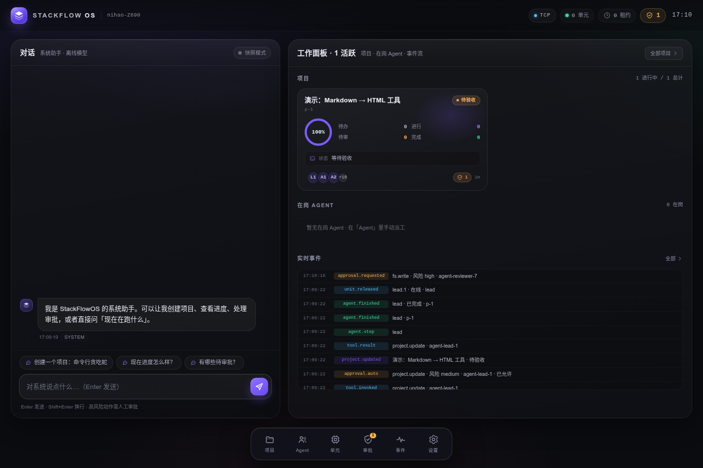

# StackFlowOS

**一个给 Agent 住的系统。**

不是更好的聊天软件，也不是又一个任务看板。它把 Agent 当成"住在机器里的进程"：
有地址、有生命周期、有资源租约、有失败域、有审计，所有高风险动作走统一审批口。

- 对话是入口，工作面板是现场（`对话 + 项目卡片 + 任务 + 实时事件`）
- L0 用 **pynng**，`ipc://` 与 `tcp://` 同一种 wire 协议，进程内进程外一套代码
- L1 继承 **Cordis** 的内核语义：`Context` 树、`effect`/disposer 逆序回收、服务注入、类型化事件
- L2 是真正新建的部分：**能力目录 · 租约 · 失败域 · append-only 事件流**
- 项目是卡片，Agent 是工人：随项目生、随项目死，另有管理推进与数据汇总角色
- 每个工人 Agent 是一个独立进程；危险动作走审批；放行规则由人定义，审计只读、不可改
- **系统助手是操作员代理**：通过对话下达的管理指令直接执行（含审批放行/拒绝、
  改配置、归档/删除项目），每次动作写入 `operator.action` 审计；工人仍受审批约束

> 设计与判断的完整推导见 [docs/vision.md](docs/vision.md)，
> 实现契约见 [docs/architecture.md](docs/architecture.md)。

---

## 快速开始

环境：Linux、Python ≥ 3.11、`pynng`（已安装 0.9.0 时无需其他依赖）。

```bash
# 1) 启动系统（默认 IPC；浏览器打开 http://127.0.0.1:17800）
python3 -m stackflowos hub

# 2) 一键演示：自动建项目、派 Agent、真实写文件、跑自检
python3 -m stackflowos demo --until-done
#    不带 --until-done 时 hub 会保持运行，方便打开 http://127.0.0.1:17800 看界面

# 3) 换 TCP 传输（同一套协议，地址从 ipc:// 变成 tcp://）
python3 -m stackflowos hub --transport tcp

# 4) 环境自检 / 查看正在运行的 hub
python3 -m stackflowos doctor
python3 -m stackflowos status
```

`demo --until-done` 会真的在 `.stackflowos/projects/<id>/workspace/` 里留下设计文档、
实现文件、测试报告和评审意见，并在终端打印任务终态与产物路径。演示项目目标是
"Markdown → HTML 命令行工具"，产出的 `src/*.py` 是可运行的真实程序
（`python3 src/t-3-*.py --selftest` 会通过），最后由 aggregator 写出项目简报。

演示会预置一组**项目范围内**的放行规则（只允许项目工作区内的读写和无害命令），
这是"人给系统定的规矩"，不是绕过审批；项目之外的写入仍然会弹审批。

---

## 界面

首屏是**对话框**，旁边是**工作面板**（项目卡片 / 进度环 / 当前任务 / 在岗 Agent / 实时事件）。
底部 Dock 打开六个"App"：

| App | 内容 |
|---|---|
| 项目 | 项目列表与创建；**接入已有目录**；项目详情（任务看板、产物、Agent、里程碑）；归档 / 永久删除（输入项目名二次确认） |
| Agent | 花名册、按角色派工、终止 |
| 单元 | 进程表：work_id、地址、状态、能力、心跳 |
| 审批 | 待审批队列（风险 / 范围 / 预览 / TTL）、放行规则编辑器、审计 |
| 事件 | 全量事件流（可过滤、可展开原始 JSON） |
| 设置 | 常规 / 网络 / AI / 安全 / 存储 / 关于 |

### 截图（真实运行中的 hub）



| 审批口（风险 / 范围 / 预览 / TTL） | 项目详情（任务看板 / 产物 / Agent） |
|---|---|
|  |  |

| 手机宽度 | 设置 |
|---|---|
|  |  |


---

## 架构

```
┌──────────────────────────────────────────────────────────────┐
│ 对话 + 工作面板（Web / SSE / 原生 JS，无构建步骤）              │
├──────────────────────────────────────────────────────────────┤
│ L2 sys 单元                                                   │
│   能力目录  Registry · 租约 Lease · 失败域 Failure             │
│   调度 Scheduler · 事件流 EventLog · 项目/任务 · 权限审批       │
├──────────────────────────────────────────────────────────────┤
│ L1 内核 Context 树 / effect / 服务注入 / 事件语义（Cordis 风格）│
├──────────────────────────────────────────────────────────────┤
│ L0 pynng 传输 REQ/REP（控制面）+ PUB/SUB（事件面）             │
│   地址：ipc://<run>/<work_id>.rpc.sock | tcp://host:port      │
└──────────────────────────────────────────────────────────────┘
```

进程拓扑：

```
hub 进程（sys.0）
 ├─ pynng REP  : 所有单元的 RPC（allocate/register/heartbeat/lease/approval/...）
 ├─ pynng SUB  : 聚合所有单元的事件
 └─ Web/SSE    : 浏览器

worker 进程（coder.3 / lead.2 / reviewer.7 ...）
 ├─ 自己的 REP : 接收 hub 的 unit.pause/resume/kill/status
 ├─ 自己的 PUB : 把事件发给 hub 的 SUB
 └─ 本地执行工具: 读写项目工作区、跑命令；动作前向 sys 申请能力
```

**为什么一个 Agent 一个进程？** 因为"进程"是真实世界里的隔离、生命周期与
资源归属单位。worker 崩了是失败域问题，不是异常处理问题；项目归档时杀进程，
比"把状态标记成归档"更接近一个系统该有的行为。

### IPC 与 TCP 是同一件事

`pynng` 的 NNG 协议在两种 transport 上是同一套消息语义。切换只改配置：

```python
transport.mode = "ipc"   # ipc://<state>/run/<work_id>.rpc.sock
transport.mode = "tcp"   # tcp://127.0.0.1:<port>（advertise_host 可指向远端可达地址）
```

单元启动时向 sys 要地址（`unit.addresses`），然后绑定自己的 REP/PUB。
换设备时，把 hub 的 `sys_rpc` 换成 `tcp://<host>:<port>` 即可让那台设备上的
worker 接进来——语义上它就是同一台机器上的另一个进程。

---

## 核心概念

### 单元（Unit）

一个可寻址的运行实例，`work_id = <kind>.<n>`，等价于 PID：

- `sys.0`：内核 + sys 单元
- `lead.2`：项目主理人，与项目同生灭
- `coder.3`：任务工人，任务结束即退出
- `agg.1`：数据汇总，周期性更新项目 brief

单元注册时声明**能力**（不是"我装了什么"，而是"我现在能承诺什么"），
心跳超时后进入 suspect → offline，由失败域决定重启、降级还是隔离。

### 租约（Lease）

```python
lease = {
  "resource": "project:p-1:lead",   # 或 unit:coder.3 / file:<abs> / cap:<name>
  "holder": "lead.2",
  "ttl_s": 300, "renewable": True, "preemptible": False,
}
```

同一资源同时只有一个持有者；冲突返回持有者信息，可抢占资源按优先级抢占。
到期自动释放并广播 `lease.expired`。**没有租约，AI 不敢接长任务**——
"我占着这块资源到什么时候"必须能被回答。

每个 unit 注册时会自动持有 `unit:<work_id>` 的身份租约，心跳续期、退出或失联时
由失败域释放；它让"进程占着这个地址到什么时候"成为可查询事实，也直接显示在
状态栏的租约计数里。

### 失败域（Failure Domain）

单位死亡不是"一个报错"，是一组后果：

1. 释放它持有的全部租约；
2. 发送 `unit.offline` / `failure.detected`；
3. 按 kind 的策略重启（有预算、有窗口，不允许无限重启）；
4. 超预算 → 隔离（quarantined），项目标记 degraded；
5. 它名下的任务回到 `todo`，让主理人重新派工。

### 事件流（Event Log）

append-only JSONL（`<state>/events/events.jsonl`），全局单调 `seq`，
支持 `since(seq)` 重放。UI 的 SSE 断线后按 `lastSeq` 续传。
聊天、审批、任务、Agent 的一生都在同一条流里——审计不是另一张表。

### 已有目录 → 项目

项目有两种工作区：

- **系统工作区**：新建项目时由系统分配 `<state>/projects/<id>/workspace`；
- **接入已有目录**：在项目页「接入已有目录」，或对话里说
  「打开 /home/you/project 这个项目」。系统只登记路径，不复制、不移动、不删除。
  默认 **只读**（Agent 可读/列，写文件和 shell 被拒绝）；勾选“允许 Agent 写入”
  （或在对话里说“把 StackFlowOS 改成可写”）才切到可写，写操作仍走能力审批；
  项目详情可随时切回只读。删除项目只删登记记录，外部目录永远保留。

### 权限（Capability → Risk → Policy → Approval → Grant → Audit）

能力不是布尔开关，带范围和风险：

| 能力 | 风险 | 范围 |
|---|---|---|
| `fs.read` / `fs.list` | low | path |
| `fs.write` | medium | path（项目工作区外升 high） |
| `fs.delete` | high | path |
| `shell.exec` | high | cwd + command（危险模式始终 high） |
| `net.fetch` | medium | url |
| `agent.spawn` | medium | project + role |
| `unit.control` / `sys.config` | high | work_id / section |

判定顺序：**deny 优先 → 允许规则（risk_max 且范围匹配）→ 默认策略**
（low 可自动放行，medium/high 默认询问）。

审批口就是手机 App 的权限弹窗：

- **允许一次**：一次性 grant，用完即失效
- **允许 1 小时**：session grant
- **总是允许**：落成一条规则，可在设置里删除
- **拒绝**：动作失败，Agent 收到 `DENIED`
- 没人处理时到期自动拒绝（fail closed）
- 放行规则可限定 principal（`coder.*`）、路径前缀、命令正则、域名、项目、风险上限

执行模型是**能力委托**：worker 在本地执行，sys 授权并审计。这对应内核给进程发 fd；
已知限制是 worker 本身可信（见"边界"）。

**操作员助手**：对话框里的「系统助手」是人的代理，拥有系统管理权限——项目/任务/
Agent/单元/审批/规则/配置/租约/项目文件都能直接操作，不再弹审批；代价是它不能
碰宿主 shell，且每次调用都写入不可变的 `operator.action` 事件。工人 Agent 不共享
这个特权，仍走审批。

### Agent 角色

| 角色 | 生命周期 | 职责 |
|---|---|---|
| `lead` | 随项目 | 拆解目标、建任务、派工、推进、汇总 |
| `architect` / `coder` / `tester` / `reviewer` / `researcher` | 随任务 | 设计 / 实现 / 测试 / 评审 / 调研 |
| `aggregator` | 项目内周期（默认 240s / demo 收尾时一次） | 读事件与任务，更新项目 brief |
| `assistant` | hub 常驻 | 对话框里的系统助手 |

Agent 的工具调用一律经过 `ToolExecutor`：
路径必须落在项目工作区、shell 有 cwd 限制与超时、敏感环境变量被剔除、
输出截断并留档，每次调用前后都发事件。

---

## 配置

优先级：内置默认 < `<repo>/.stackflowos/config.json` < 环境变量。

常用项：

```json
{
  "transport": { "mode": "ipc", "host": "127.0.0.1", "advertise_host": null,
                 "port_pool_start": 17820, "port_pool_end": 17899 },
  "web": { "host": "127.0.0.1", "port": 17800 },
  "security": { "auto_allow_low": true, "medium_default": "ask",
                "high_default": "ask", "approval_ttl_s": 300,
                "grant_ttl_s": 3600, "allow_shell": true },
  "llm": { "provider": "mock", "base_url": "", "model": "", "api_key": "" },
  "agents": { "heartbeat_s": 2.0, "offline_after_s": 8.0, "max_workers": 6 }
}
```

环境变量：`SFO_ROOT`、`SFO_STATE_DIR`、`SFO_WEB_PORT`、`SFO_TRANSPORT_MODE`、
`SFO_LLM_PROVIDER`、`SFO_LLM_BASE_URL`、`SFO_LLM_MODEL`、`SFO_LLM_API_KEY`。

所有运行期数据都在 `<repo>/.stackflowos/`（已被 `.gitignore` 忽略）：
`config.json`、`events/`、`logs/`、`projects/<id>/workspace/`、`state/`。

---

## 接入真实模型

默认 `llm.provider = mock`：完全离线、确定性，演示和测试用它。
要接 OpenAI 兼容端点，在「设置 → AI」里改（或写配置）：

```json
{ "llm": { "provider": "openai", "base_url": "http://127.0.0.1:11434/v1",
           "model": "qwen2.5:7b", "api_key": "" } }
```

保存后**立即生效**：hub 会重建 chat provider，下一次对话就使用新模型，不需要重启。
`base_url` 可以写 `http://host:port` 或 `http://host:port/v1`，客户端会依次尝试
`/v1/chat/completions`、`/chat/completions`、`/api/chat/completions`；设置页的
「测试连接」会发一个最小请求并显示耗时/错误。`max_tokens` 会原样发送，不再被系统裁剪；上限由模型端点决定，
填错时「测试连接」会显示端点的具体错误。

worker 的新进程会读取新配置；已在跑的 Agent 用 spawn 时的配置。
模型只影响"怎么想"，不影响"能不能动"——工具调用仍走审批。

---

## 命令

```
stackflowos hub      [--transport ipc|tcp] [--port 17800] [--no-web]
stackflowos demo     [--until-done] [--timeout 240] [--goal ...]
stackflowos doctor
stackflowos status   [--url http://127.0.0.1:17800]
stackflowos attach   --sys tcp://<hub>:17820 --role coder --project p-1
stackflowos worker   （内部：由 supervisor 拉起）
```

`attach` 让一台设备/一个终端手动接入运行中的 hub：向 hub 申请一个 unit 地址，
在本机起一个 worker 进程；它是 supervisor 内部拉起工人的同一条路径。

---

## 测试

```bash
python3 -m unittest discover -s tests -t . -v
```

- 内核：effect 逆序、插件卸载、waterfall 否决、serial/bail
- 传输：ipc/tcp RPC、错误映射、并发、pub/sub、异常帧
- L2：租约冲突/过期/抢占、心跳状态机、失败域重启预算、事件重放
- 权限：风险升级、deny 优先、规则过期、审批一次/会话/永久、fail closed
- 项目/Agent：状态机、认领冲突、工具审批、路径逃逸、进程管理
- 集成：真实 hub + 多 worker（ipc 与 tcp），端到端完成任务并检查产物

---

## 边界与已知限制（诚实清单）

1. **单 hub。** 没有集群选主/分片；跨设备可以接进来，但 sys 仍是单点。
2. **没有设备发现。** TCP 地址需要显式配置，不做 mDNS/组网。
3. **worker 可信。** 工具在 worker 本地执行，sys 授权并审计；恶意 worker
   可以绕过本地检查直接改文件。接不可信设备时要把执行搬进 sys 侧沙箱。
4. **文件沙箱是路径白名单**，不是容器/命名空间；shell 仍拥有进程用户的权限。
5. **无鉴权。** 默认只绑 `127.0.0.1`；暴露到网络前必须自己加反代/鉴权。
6. **mock 大脑不是智能。** 它按角色产出确定性的真实工作，用来验证系统；
   真智能来自外接模型。
7. **L0 用 pynng，不是 libzmq。** 与 StackFlow 的 ZMQ 不能直连；
   若要和在跑的 StackFlow 设备互通，需要写 bridge。这是替代关系，不是叠加。

---

## 与 StackFlow / Cordis 的关系

| | StackFlow | Cordis | StackFlowOS |
|---|---|---|---|
| 层次 | L0 设备运行时 | L1 插件语义 | **L2 编排 + 完整系统** |
| 寻址 | `work_id` + 端口池 | 进程内 Context | 跨进程 work_id + 地址分配 |
| 生命周期 | setup/link/exit | effect/disposer | 单元进程 + 失败域 + 项目绑定 |
| 缺什么 | 编排、权限、租约 | 远程 Context | ——（本项目的重点） |

本项目没有 fork StackFlow，也没有重新发明 Cordis：它把两者的正确部分当作
约束（窄契约 + 可逆副作用），在它们之上补了真实世界最缺的那一层。

---

## 原始想法（立项时的原文）

> 现在的 Agent 软件，偏对话的也好，偏任务看板的也好，感觉终归是一个软件来看的。
> 我觉的是不太满足 AI 对于系统的要求。
> 在这方面走的比较远的就是 deepseek 了，dsh harness 和 super agent 是对 AI 面向人们交互的探索。
> ……
> 如果从 Cordis 开始，首先的限制就是，Cordis 是无法多设备联动执行的。
> 如果从 StackFlow 开始，也许是一个很好的选择。

完整原文与逐条展开见 [docs/vision.md](docs/vision.md)（原始判断在那份文档里保留）。
