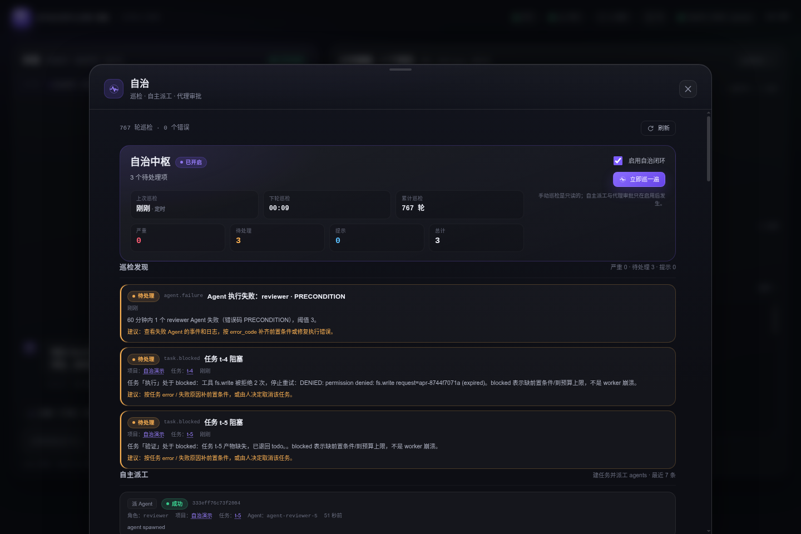

# 自治闭环：巡检、派工、代理审批

> 一个 OS 不该等人先发现"系统不对"，再等人点"派工"，再等人点"批准"。
> StackFlowOS 的自治中枢（`autonomy.0`）把这三件事变成一个受人类策略约束、
> 全程可审计的循环：
>
> ```
>          ┌──────────────── 事件流 / 状态 / UI ────────────────┐
>          ▼                                                  │
>   ① 巡检 patrol ──findings──▶ ② 派工 dispatch ──任务/Agent──▶ ③ 代理审批 guardian
>   （只读检查）                 （受配额/冷却约束）              （人类先授权，系统后执行）
>          │                                                  │
>          └──────────── 下一轮：新状态变成新 finding ◀────────┘
> ```

代码位置：`stackflowos/autonomy/`（`patrol.py` / `dispatcher.py` /
`guardian.py` / `service.py` / `api.py`）。它是第 15 个扩展（`build(app)`），
不修改 `app.py` 的组合逻辑；`app.autonomy` 指向同一个实例。

---

## 1. 三个开关，默认全关

```json
{
  "autonomy": {
    "enabled": false,
    "dispatch_mode": "off",
    "approve_mode": "off"
  }
}
```

| 开关 | 值 | 行为 |
|---|---|---|
| `enabled` | `true/false` | 总闸。关 = 不跑周期循环、不派工、不代审批；手动巡检仍可用（只读） |
| `dispatch_mode` | `off` | 巡检只报告 |
| | `tasks` | 对"没有任务"的 finding 建补救任务，但不拉 Agent |
| | `agents` | 建任务 + 拉起对应角色的工人（受配额/冷却/在岗上限约束） |
| `approve_mode` | `off` | 不看审批队列 |
| | `observe` | 只记录"如果是我会怎么批"，不动审批（用来建立信任） |
| | `enforce` | 在人类预授权的围栏内，以 `autonomy:guardian` 身份逐条放行 |

默认值刻意保守：**关着的时候，系统行为和以前完全一样**。推荐的启用顺序是
`enabled=true + dispatch_mode=tasks + approve_mode=observe`，观察一两天
`autonomy.dispatched` / `autonomy.approval` 事件后再打开 `agents` / `enforce`。

GUI：Dock →「自治」。CLI：

```bash
sfo autonomy status            # 巡检发现 / 最近的派工与代理审批
sfo autonomy patrol --dry-run  # 只巡一遍，不动手
sfo autonomy set --enabled --dispatch tasks --approve observe
sfo autonomy set --disabled    # 急停
```



---

## 2. 巡检（patrol）：系统自己发现问题

巡检是**只读**的：它收集一份 `Snapshot`（health/stats/units/agents/projects/
tasks/approvals/leases/events/project_health），用纯函数产出 `Finding`。
不写项目、不写任务、不碰审批；发现本身不产生副作用。

| check | 何时出现 | 严重度 | 可派工 |
|---|---|---|---|
| `hub.degraded` | `/api/health.status != ok`（transport/eventlog 异常） | critical | — |
| `unit.problem` | 非 worker 单元 failed/unreachable，或 status failed | critical | — |
| `project.degraded` | 项目被失败域标记 degraded | critical | — |
| `project.no_plan` | active 项目没有任何任务、也没有在岗 lead | warn | spawn lead |
| `project.health` | 入住自检 `ready=false`（带前 3 个失败项与 fix） | warn | — |
| `task.idle` | todo 任务无人认领、依赖已完成、闲置超过 `task_idle_s` | warn | spawn `task.role`（缺省 coder） |
| `task.stalled` | doing 任务无在岗 Agent 且超过 `task_timeout_s` | warn | —（失败域负责重排） |
| `task.review` | review 任务无人处理、闲置超过 `task_idle_s` | warn | spawn reviewer |
| `task.blocked` | 任务处于 blocked（缺前置条件/到预算上限） | warn | —（要补条件，不是再派工） |
| `agent.failure` | 窗口内 blocked/failed Agent 按（角色, error_code）聚合 | warn / critical | — |
| `approval.pending` | 审批等待超过 `approval_age_s`（>10min 升 critical） | warn | — |
| `approval.denial` | 窗口内同类能力被拒 ≥3 次（策略缺口信号） | warn | — |
| `lease.orphan` | 活跃租约的持有者已不在岗 | warn | — |
| `events.failure_burst` | 窗口内 `unit.failed/agent.failed/tool.error` 超过阈值 | critical | — |

Findings 的 `fingerprint` 只由检查名和对象 id 组成，因此**同一个问题跨轮巡检
指纹不变**：报告只对"新出现"的 warning/critical 写 `autonomy.finding` 事件，
不会每 2 分钟刷同一屏。

报告保存在 `<state>/state/autonomy.json`：最新报告 + 最近 `report_keep` 轮摘要
（含 headline、severity 计数、错误）。UI/API 读同一份，不重新跑检查。

---

## 3. 派工（dispatch）：把发现变成工作

派工只处理带 `DispatchHint` 的 finding，且必须通过这些闸门：

* **项目边界**：项目必须存在、工作区可用、状态 `active/review/degraded`；
  `attached-ro`（只读接入）项目不派工；archived/done 跳过。
* **幂等**：同一 fingerprint 有未过冷却的记录 → 跳过；同一 task 已有在岗或
  排队的 Agent → 跳过。
* **预算**：每小时最多 `dispatch_max_tasks_per_hour` 个新任务、
  `dispatch_max_spawns_per_hour` 次 spawn、同时最多 `dispatch_max_agents`
  个由自治派出的在岗 Agent；每轮最多 5 个动作。
* **冷却**：成功或失败后 `dispatch_cooldown_s` 内不重复尝试；失败记录
  `status=error`，冷却后允许重试一次（每次仍受配额约束）。
* **审计**：任务 `created_by="autonomy:governor"`，描述末尾带
  `[autonomy:<fingerprint>]`；spawn 走 `app.spawn_agent`（与人工派工同一路径），
  写 `autonomy.dispatched`。

两类动作：

| hint.kind | `tasks` 模式 | `agents` 模式 |
|---|---|---|
| `task` | 建任务（如空项目 → "启动项目：拆解目标与派工"） | 建任务后同轮派工 |
| `spawn` | 不动作 | 直接为已有任务派工 |

派工失败（队列满、workspace 消失、任务被抢）不会让巡检失败：记录错误，
下一轮 `task.idle` 会再次发现它。

---

## 4. 代理审批（guardian）：人类先授权，系统后执行

guardian **不创建规则、不伪造 grant**，只对排队中的请求调用正常的
`app.decide_approval(..., mode="once", by="autonomy:guardian")`。每条请求
单独决定一次；决定写 `approval.decided`（`decided_by` 可区分人/系统）与
`autonomy.approval`（带理由）。

### 4.1 围栏（全部满足才放行）

1. 请求仍是 `pending`；principal 必须是 worker（`agent-*`）；
2. capability 在 `approve_capabilities` 里，且不在硬拒绝集合：
   `fs.delete / unit.control / sys.config / project.* / agent.kill /
   approval.decide` —— 这些**永远**需要人；
3. 风险 ≤ `approve_risk_max`；
4. 项目存在、状态不是 archived/done；`approve_projects` 非空时必须在白名单；
5. `fs.write`：路径解析后必须落在项目 workspace 内，且不能写 `.git/`；
   只读接入项目直接跳过；
6. `agent.spawn`：角色在 `approve_roles`，同项目在岗 Agent 少于
   `approve_max_agents_per_project`；
7. `shell.exec`（默认关闭）：必须 `approve_shell=true` + 命中
   `approve_shell_patterns` 的某个 `re.fullmatch` + cwd 在 workspace 内 +
   命令不含 shell 控制符 + `approve_risk_max="high"`；
8. `net.fetch`（默认关闭）：主机必须命中 `approve_domains`；
9. 人类否决冷却：最近 `approve_deny_cooldown_s` 内，同一角色+能力的请求
   被人拒绝过 → 跳过（尊重人的判断，不"再替你试试"）；
10. 速率：每小时放行数 < `approve_max_per_hour`；`approve_min_age_s`
    可以强制"先让人看一会儿"；
11. `observe` 模式只记录建议，不消耗速率、不改审批状态。

### 4.2 为什么默认允许 `fs.write` 和 `agent.spawn`

这两个是"Agent 正常干活"最常卡住的中等风险动作：coder 写项目文件、lead
为自己的项目补工人。它们的围栏都是**项目内、有上限、可审计**的。
`shell.exec` 是任意代码执行，默认保持人审；确实需要无人值守时，由人写下
明确的正则白名单再显式打开，而不是让系统自己决定。

---

## 5. 事件与 API

事件（`source="autonomy"`）：

```
autonomy.patrol.started / autonomy.patrol.completed
autonomy.finding            # 仅新出现的 warn/critical（最多 20 条/轮）
autonomy.dispatched         # 建任务 / 派工（ok 或 error）
autonomy.approval           # 代理审批的 allow/observe
autonomy.policy.changed / autonomy.error
```

`autonomy.patrol.completed` 自带 `summary/headline/new/resolved`，UI 可以不查
单条 finding 就显示"这一轮发生了什么"。

HTTP（需要登录；写操作需 operator）：

| 方法 | 路径 | 说明 |
|---|---|---|
| GET | `/api/autonomy`、`/api/autonomy/status` | 策略、计数、findings、报告、历史、派工/审批记录、配额 |
| POST | `/api/autonomy/patrol` | `{dry_run?: bool}` 立即巡一轮 |
| PATCH | `/api/autonomy/policy` | 局部策略；校验后持久化并热生效 |

对话入口（系统助手）：`autonomy.status`、`autonomy.patrol`、
`autonomy.configure`（需 `confirm=autonomy`）。

---

## 6. 安全边界与已知限制

1. **自治不是"系统给自己放权"**：guardian 只能在人写好的配置围栏内放行；
   改围栏本身是 `sys.config`（高危、人审/操作员）。
2. **派工不经过审批**：`dispatch_mode=agents` 是操作员显式授权的运营动作，
   与系统助手直接派工同级，写 `autonomy.dispatched` 审计。它仍然受
   `agents.max_workers`、项目 scope/workspace 和本模块配额约束。
3. **只处理"确定性可判定"的问题**：巡检是规则/阈值，不是 LLM 判断；
   需要理解的修复仍由工人 Agent 的模型完成。
4. **单 hub 假设**：状态文件 `state/autonomy.json` 由 hub 进程独占（已有
   hub 锁）；冷备接管时从同一文件恢复，运行中的一轮会被中断。
5. **配额是内存+文件计数**：进程崩溃可能丢失最近几个时间戳，最坏情况是
   重启后略超配额，不会无上限。
6. **不是分布式调度器**：多 hub/多设备下没有全局唯一 governor；同一状态目录
   仍由 hub 锁保证单写者。
7. **guardian 只看得到审批请求本身**：它无法验证工人是否"真的需要"这次写，
   只能保证动作落在预授权范围内；越界/异常行为仍要人看审计。

---

## 7. 一次完整闭环（可复制）

```bash
# 1) 打开「观察模式」：只巡检 + 只建议审批，不动作
sfo autonomy set --enabled --dispatch tasks --approve observe

# 2) 看一轮
sfo autonomy patrol --dry-run
sfo autonomy status

# 3) 信任之后，放开派工与项目内写文件审批
sfo autonomy set --dispatch agents --approve enforce

# 4) 任何时候急停
sfo autonomy set --disabled
```

GUI 的「自治」应用给出同样的开关，并逐条显示：发现了什么、为什么派/没派、
代理审批的每一条理由。所有动作都能在「事件」应用里按 `autonomy` 前缀回放。
